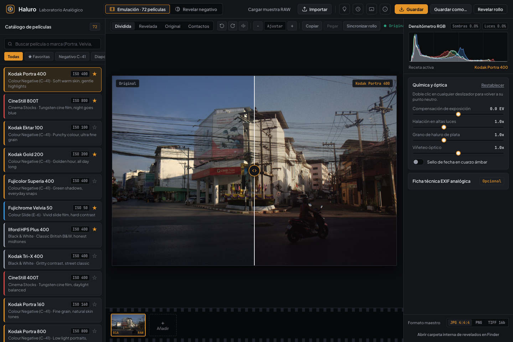
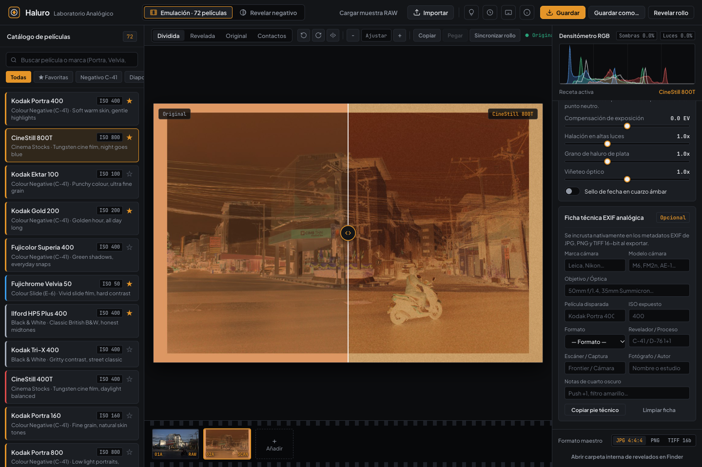
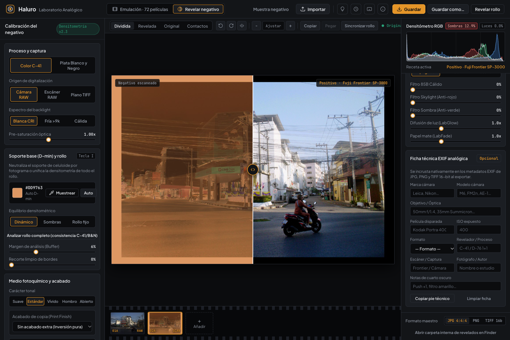
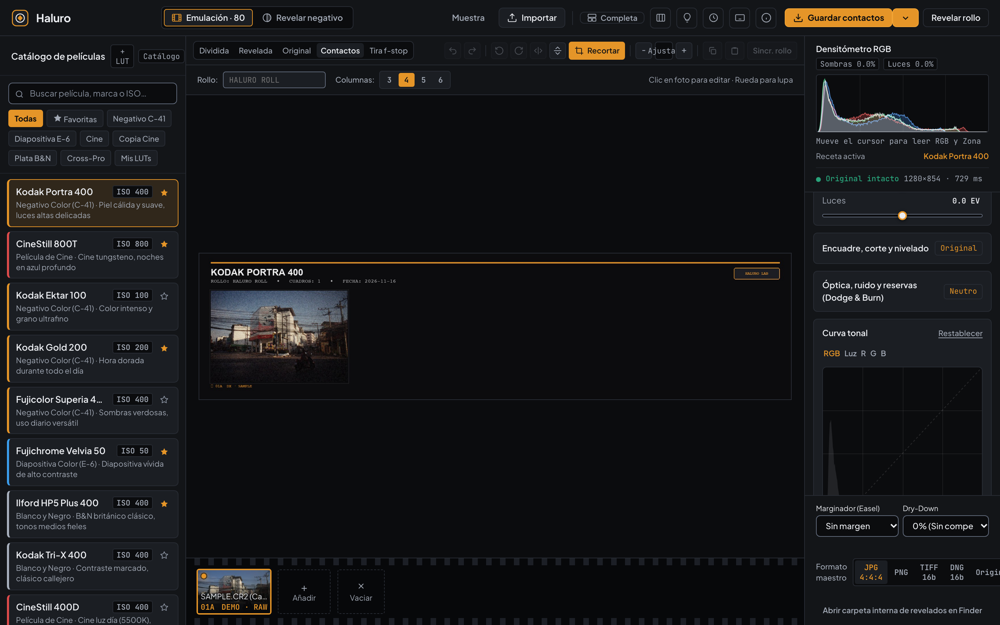

# Haluro 2.5.0 — Manual Oficial de Usuario y Guía de Cuarto Oscuro

Bienvenido al manual oficial de **Haluro**, una estación de trabajo fotográfica concebida desde la práctica y los principios de la fotoquímica analógica. Esta guía detalla cada módulo, herramienta, atajo de teclado y proceso de calibración para obtener el máximo rendimiento tanto en la inversión de negativos digitalizados con cámara como en la emulación de emulsiones cinematográficas y fotográficas clásicas.

---

## Tabla de Contenido

1. [Requisitos e Instalación](#1-requisitos-e-instalación)
   - [macOS (Apple Silicon e Intel)](#macos-apple-silicon-e-intel)
   - [Windows 11](#windows-11)
2. [Arquitectura de la Interfaz y Mesa de Luz](#2-arquitectura-de-la-interfaz-y-mesa-de-luz)
   - [Importación de Archivos](#importación-de-archivos)
   - [Atajos de Teclado Universales](#atajos-de-teclado-universales)
3. [Modo 1: Laboratorio de Inversión de Negativos](#3-modo-1-laboratorio-de-inversión-de-negativos)
   - [El Concepto Clave: D-min (Densidad Mínima)](#el-concepto-clave-d-min-densidad-mínima)
   - [Muestreo Óptico del Soporte Base](#muestreo-óptico-del-soporte-base)
   - [Perfiles de Escáner de Laboratorio (Fuji Frontier vs. Noritsu)](#perfiles-de-escáner-de-laboratorio-fuji-frontier-vs-noritsu)
   - [Cabezal Dicroico CMY y Balance de 3 Vías](#cabezal-dicroico-cmy-y-balance-de-3-vías)
   - [Control de Revelado: Latitud Pull ↔ Push](#control-de-revelado-latitud-pull--push)
4. [Modo 2: Emulación · 72 Películas Químicas](#4-modo-2-emulación--72-películas-químicas)
   - [Las 72 Emulsiones Clásicas](#las-72-emulsiones-clásicas)
5. [Efectos Fotoquímicos y Ópticos](#5-efectos-fotoquímicos-y-ópticos)
   - [Halación Analógica (Capa Antihalo)](#halación-analógica-capa-antihalo)
   - [Grano de Haluro de Plata (Cúbico vs. Tabular T-Grain)](#grano-de-haluro-de-plata-cúbico-vs-tabular-t-grain)
   - [Virados Químicos de Papel (B&N)](#virados-químicos-de-papel-bn)
6. [Metadatos Analógicos (Analog EXIF) y Exportación](#6-metadatos-analógicos-analog-exif-y-exportación)
   - [Registro de Cámara, Lente y Revelado](#registro-de-cámara-lente-y-revelado)
   - [Formatos de Salida (TIFF 16-bit, PNG y JPEG)](#formatos-de-salida-tiff-16-bit-png-y-jpeg)
   - [Procesamiento por Lotes y Mesa de Luz de Contactos](#procesamiento-por-lotes-y-mesa-de-luz-de-contactos)
7. [Preguntas Frecuentes y Resolución de Problemas](#7-preguntas-frecuentes-y-resolución-de-problemas)

---

## 1. Requisitos e Instalación

### macOS (Apple Silicon e Intel)

Haluro cuenta con paquetes nativos optimizados para las dos arquitecturas de computadores Apple:

| Arquitectura de Mac | Archivo a Descargar |
| :--- | :--- |
| **Apple Silicon (M1, M2, M3, M4)** | `Haluro-2.5.0-macOS-arm64.dmg` |
| **Procesadores Intel (Core i5, i7, i9, Xeon)** | `Haluro-2.5.0-macOS-x86_64.dmg` |

#### Pasos de Instalación:
1. Haz doble clic sobre el archivo `.dmg` correspondiente a tu procesador.
2. En la ventana que se abre, arrastra el icono de **Haluro** hacia el acceso directo de tu carpeta **Aplicaciones**.
3. Expulsa la imagen de disco y abre Haluro desde Launchpad, Spotlight o tu carpeta de Aplicaciones.

> [!IMPORTANT]
> **Primer arranque en macOS Sequoia (macOS 15) o Sonoma (macOS 14):**  
> Al ser una aplicación independiente y artesanal, el sistema Gatekeeper de Apple mostrará un diálogo preventivo: *«Apple no pudo verificar que Haluro no contenga software malicioso»*.  
> **Para autorizar la app por única vez:**
> 1. Haz clic en **«Listo»** en el cuadro de diálogo.
> 2. Dirígete a **Ajustes del Sistema () > Privacidad y seguridad** y baja hasta la sección **Seguridad**.
> 3. Haz clic en el botón **«Abrir de todos modos»** e ingresa la contraseña o Touch ID de tu Mac.  
> *(Alternativa rápida en Terminal: `xattr -cr /Applications/Haluro.app`)*. A partir de ese momento, la app abrirá de inmediato con doble clic.

---

### Windows 11

* **Archivo requerido:** `Haluro-Setup-2.5.0-Win11-x64.exe` (o la versión portátil `Haluro-Portable-2.5.0-Win11-x64.zip`).
* **Instalación:** Ejecuta el instalador. No requiere permisos de administrador forzados (instalación limpia por usuario) y se integra automáticamente con el motor **Microsoft Edge WebView2** preinstalado en Windows 11.

---

## 2. Arquitectura de la Interfaz y Mesa de Luz

La interfaz de Haluro está organizada en tres áreas principales diseñadas para minimizar la fatiga visual en sesiones prolongadas de edición:

1. **Barra Superior (Cabecera):**
   - Selector de modo: **«Emulación · 72»** (simulación de películas químicas) vs. **«Revelar negativo»** (inversión densitométrica de negativos C-41 y B&N).
   - **Muestra:** Carga automática de una fotografía RAW o un negativo de prueba según el modo activo.
   - **Importar:** Selector de archivos (`⌘O` / `Ctrl+O`) para cargar fotografías o escaneos individuales o en rollo.
   - Utilidades rápidas: **Luz roja de cuarto oscuro (`L`)**, **Historial de versiones reveladas**, **Atajos de teclado (`?`)** y **Acerca de Haluro / Actualizaciones**.
   - Grupo de exportación contextual: botón principal **Guardar** (que cambia a **Guardar contactos** en la pestaña *Contactos*), menú desplegable con **Guardar como…** (`⇧⌘S` / `Ctrl+Shift+S`) y **Guardar solo contactos**, más **Revelar rollo** para procesado completo en paralelo.

2. **Mesa de Luz Central y Tira de 35 mm:**
   - Área de previsualización de alta fidelidad (con pantalla de bienvenida guiada cuando la mesa de luz está vacía) e indicador de edición no destructiva (`Original intacto`, resolución y latencia).
   - Barra de herramientas con modos de vista (**Dividida** `1`, **Revelada** `2`, **Original** `\`, **Contactos** `3`), rotación izquierda/derecha (`⇧R` / `R`), espejo horizontal de emulsión (`F`), lupa (`-`, **Ajustar** `0`, `+` o rueda del ratón) y transferencia de recetas (**Copiar**, **Pegar**, **Sincronizar rollo**).
   - Tira perforada de 35 mm inferior con navegación por fotogramas (`←` / `→`), punto ámbar en tomas personalizadas, botón **+ Añadir** y **× Vaciar**.

3. **Paneles Laterales:**
   - **Panel Izquierdo:** Catálogo buscable de 72 películas con filtros en español (`Todas`, `★ Favoritas`, `Negativo C-41`, `Diapositiva E-6`, `Cine`, `Plata B&N`, `Cross-Pro`) en modo *Emulación*, o calibración de soporte base D-min, perfiles de escáner y virados B&N en modo *Revelar negativo*.
   - **Panel Derecho (Inspector):** **Densitómetro RGB** en vivo (lectura de sombras y luces recortadas), controles de **Química y óptica** / **Zonas tonales** (sombras, tonos medios y luces) / **Curva tonal** (editor de curva) / **Curva tonal y proceso**, **Ampliadora CMY y 3 vías**, **Filtros y nitidez óptica**, **Ficha técnica EXIF analógica** y selector de **Formato maestro** (`JPG 4:4:4`, `PNG`, `TIFF 16b`).

---

### Importación de Archivos

Haluro procesa de forma nativa los siguientes formatos:
* **Archivos RAW de cámara:** Canon (`.CR2`, `.CR3`), Nikon (`.NEF`), Sony (`.ARW`), Fujifilm (`.RAF`), Panasonic/Leica (`.RW2`), Olympus (`.ORF`) y negativos digitalizados en formato abierto `.DNG`.
* **Imágenes ráster de alta fidelidad:** `.TIFF` (8 y 16 bits por canal) y `.JPEG` de máxima calidad.

Para importar, basta con **arrastrar y soltar** uno o varios archivos directamente sobre la mesa de luz central, o presionar `⌘O` (`Ctrl+O` en Windows).

---

### Atajos de Teclado Universales

| Atajo (macOS) | Atajo (Windows) | Acción |
| :---: | :---: | :--- |
| `⌘ + O` | `Ctrl + O` | Abrir selector de archivos para importar |
| `⌘ + Z / ⇧ + ⌘ + Z` | `Ctrl + Z / Ctrl + Y` | Deshacer y rehacer ajustes sobre el fotograma activo |
| `←` / `→` | `←` / `→` | Saltar al fotograma anterior o siguiente del rollo |
| `1` / `2` / `3` | `1` / `2` / `3` | Cambiar entre vista **Dividida**, **Revelada** y **Contactos** |
| `\` (mantener) | `\` (mantener) | Mostrar temporalmente el fotograma original sin procesar |
| `I` | `I` | Activar cuentagotas para muestreo de soporte base D-min |
| `W` | `W` | Activar cuentagotas de gris neutro sobre el positivo |
| `R` / `⇧ + R` | `R` / `Shift + R` | Rotar imagen 90° en sentido horario o antihorario |
| `F` | `F` | Voltear horizontalmente (espejo de emulsión) |
| `+` / `-` / `0` | `+` / `-` / `0` | Acercar, alejar o ajustar el zoom completo en la mesa de luz |
| `Arrastrar (con zoom)` | `Arrastrar (con zoom)` | Desplazamiento panorámico sobre la fotografía o la hoja de contactos |
| `⇧ + ⌘ + C` / `V` | `Ctrl + Shift + C` / `V` | Copiar y pegar la receta óptica al fotograma activo |
| `⌘ + S` | `Ctrl + S` | Guardar copia maestra (o contactos) en Descargas |
| `⇧ + ⌘ + S` | `Ctrl + Shift + S` | Abrir diálogo **Guardar como…** |
| `L` | `L` | Alternar **Luz roja** ambiental de cuarto oscuro |
| `⌘ + ⌥ + Z` | `Ctrl + Alt + Z` | Modo mesa limpia: ocultar o mostrar los paneles laterales |
| `Tab` | `Tab` | Recorre la interfaz con el teclado (nunca se intercepta) |
| `Doble clic` | `Doble clic` | Restablecer un deslizador individual a su punto neutro |

---

## 3. Modo 1: Laboratorio de Inversión de Negativos

El modo **Revelar negativo** convierte digitalizaciones de película en copias positivas exactas utilizando física densitométrica en lugar de una simple inversión aritmética de curvas RGB.

### El Concepto Clave: D-min (Densidad Mínima)

En una película color negativa (como Kodak Portra o Fuji Superia), la película no es transparente: posee una **máscara naranja** compuesta por colorantes acopladores no expuestos. Esta densidad base se conoce en sensitometría como **D-min**.

Si se invierte un negativo sin restar matemáticamente el D-min exacto de esa emulsión, las sombras quedan contaminadas de cian y los medios tonos pierden fidelidad tonal.

---

### Muestreo Óptico del Soporte Base

1. Haz clic en la pestaña **«Revelar negativo»** en la barra superior.
2. En el panel izquierdo, ubica la sección **«Soporte base (D-min) y rollo»**.
3. Presiona la tecla `I` o pulsa el botón **«Muestrear»** (también puedes usar **«Auto»** para detección automática).
4. En el visor central, haz clic sobre una zona de película virgen no expuesta (el reborde perforado del carrete o el espacio entre fotogramas).
5. Haluro medirá los valores de absorción en 16 bits y neutralizará la máscara naranja de forma instantánea y no destructiva.

> [!TIP]
> **¿Qué hacer si el escaneo no tiene bordes visibles?**  
> Si tu fotografía fue recortada al ras y no tienes acceso al reborde virgen, pulsa **«Auto»** en *Soporte base (D-min) y rollo*, utiliza **«Análisis de rollo y márgenes»**, o pulsa **«Auto equilibrio»** / el cuentagotas **«Gris neutro (W)»** en la sección **«Ampliadora CMY y 3 vías»** del panel derecho.

---

### Perfiles de Escáner de Laboratorio (Fuji Frontier vs. Noritsu)

Los dos escáneres más icónicos del mundo analógico interpretan los colores de manera deliberadamente diferente. Haluro incorpora matrices de caracterización espectral de ambos equipos:

* **Fuji Frontier SP-3000:**  
  * *Características:* Tonos de piel cálidos y dorados, sombras suaves con ligero tinte pastel, verdes naturales y alta tolerancia en altas luces.  
  * *Recomendado para:* Retratos, bodas, fotografía documental y luz de atardecer.
* **Noritsu HS-1800:**  
  * *Características:* Mayor contraste general, negros más profundos, nitidez de borde muy marcada y azules/rojos altamente saturados y vibrantes.  
  * *Recomendado para:* Paisajes, arquitectura, fotografía urbana y tomas de alto contraste.

---

### Cabezal Dicroico CMY y Balance de 3 Vías

Igual que en una ampliadora de laboratorio químico (como una LPL o Beseler con cabezal de color), la corrección de dominantes cromáticas se realiza mediante sustracción de color:

* **Cian (C):** Corrige el balance de rojos en la copia.
* **Magenta (M):** Controla la relación entre verdes y magentas (esencial para ajustar el matiz de la piel).
* **Amarillo (Y):** Calibra la calidez general neutralizando sombras azuladas.

El **Balance de 3 Vías** permite aislar estos ajustes por zonas de luminancia (**Global**, **Sombras**, **Medios** y **Luces**):
* **Sombras:** Corrige la base tonal de los tonos más oscuros sin afectar el cielo ni los rostros.
* **Medios:** Ajusta el cuerpo central de la exposición (tonos de piel, follaje, ropa).
* **Luces:** Limpia los blancos puros evitando que se tiñan al mover la temperatura general.

Además, la sección **«Curva tonal y proceso»** incluye el control **Densidad neutra (Medios)** para aclarar u oscurecer la densidad de los medios tonos manteniendo intacta la cromaticidad neutra calibrada, mientras que **«Filtros y nitidez óptica»** añade acutancia en luminancia (*Apagada*, *Lab*, *Escáner*), *Intensidad de acutancia*, filtros ópticos (*Filtro 85B Cálido*, *Filtro Skylight (Anti-rojo)*, *Filtro Sombra (Anti-verde)*), *Halación y difusión suave* y *Acabado mate / velo suave*.

---

### Control de Revelado: Latitud Pull ↔ Push

El deslizador **Latitud Pull ↔ Push** (y *Compensación de exposición* en modo Emulación) simula la variación de tiempo o densidad durante el revelado:
* **Push (+0.10 a +1.00):** Aumenta el contraste de la curva característica y aporta mayor presencia tonal en negativos subexpuestos.
* **Pull (-1.00 a -0.10):** Suaviza la respuesta tonal, protege las altas luces y abre las sombras.

---

## 4. Modo 2: Emulación · 72 Películas Químicas

El modo **«Emulación · 72»** aplica perfiles matemáticos y curvas características sensitométricas (pie, zona recta y hombro) sobre imágenes positivas (digitales o escaneos ya invertidos), recreando en español el catálogo de 72 emulsiones clásicas con filtros por familia (**Todas**, **★ Favoritas**, **Negativo C-41**, **Diapositiva E-6**, **Cine**, **Plata B&N**, **Cross-Pro**).

### Las 72 Emulsiones Clásicas

El catálogo está clasificado en 5 familias químicas:

#### 1. Color Negativo (C-41)
* **Kodak Portra 160 / 400 / 800:** El estándar de la industria editorial. Separación tonal suave, grano fino y saturación contenida.
* **Kodak Ektar 100:** Grano ultrafino de tecnología T-Grain, microcontraste altísimo y colores vivos y saturados.
* **Kodak Gold 200 & ColorPlus 200:** El clásico tono cálido veraniego de los años 80 y 90, con dorados intensos y sombras cálidas.
* **Fujicolor Pro 400H:** Tonos de piel neutros con sombras ligeramente cian/verdosas y altas luces apasteladas.
* **Fujicolor Superia 400 / 800:** Grano vivaz y colores dinámicos para fotografía cotidiana de calle.

#### 2. Películas de Cine (ECN-2)
* **CineStill 800T (Tungsteno):** Emulsión cinematográfica Kodak Vision3 500T sin capa de carbón remjet. Diseñada para luz artificial nocturna (3200K), produce tonos fríos con característica halación rojiza en puntos de luz intensa.
* **CineStill 50D (Luz Día):** Grano prácticamente invisible y respuesta tonal suave para exteriores soleados.
* **Kodak Vision3 250D / 500T:** Las películas con las que se filma el cine contemporáneo de Hollywood.

#### 3. Blanco y Negro Clásico (Plata Coloidal Cúbica)
* **Kodak Tri-X 400:** El clásico del fotoperiodismo del siglo XX. Negros profundos, contraste contundente y grano orgánico marcado.
* **Ilford HP5 Plus 400:** La emulsión más versátil del laboratorio. Gradación tonal excepcionalmente amplia y sombras abiertas.
* **Ilford FP4 Plus 125:** Grano fino y detalle nítido para fotografía de estudio y paisajes.
* **Fomapan 100 / 400:** Estilo europeo tradicional de plata clásica con hombro suave en altas luces.

#### 4. Blanco y Negro Moderno (Haluros Tabulares T-Grain)
* **Kodak T-Max 100 / 400:** Emulsión con cristales de plata planos tabulares. Máxima resolución óptica y transición gris continua sin grano destructivo.
* **Ilford Delta 100 / 400 / 3200:** Rendimiento de alta velocidad con nitidez extrema en bajas condiciones de luz.

#### 5. Diapositiva / Reversible (E-6)
* **Fujichrome Velvia 50:** Máxima saturación, negros puros y contraste dramático. Legendaria en fotografía de naturaleza.
* **Fujichrome Provia 100F:** Fidelidad cromática estricta, neutralidad y grano ultrafino.
* **Kodak Ektachrome E100:** Tonos limpios, azules profundos y calidez controlada.
* **Kodachrome 64 (Proceso K-14):** La icónica emulsión de *National Geographic*, con rojos característicos y reproducción única del amarillo.

---

## 5. Efectos Fotoquímicos y Ópticos

Haluro no superpone capas transparentes de textura artificial. Cada efecto modela una propiedad física real de la materia fotográfica:

---

### Zonas Tonales (Sombras, Tonos Medios y Luces)

En el modo **«Emulación · 72»**, la sección **«Zonas tonales»** del inspector permite repartir la exposición entre las tres regiones del rango tonal, igual que se reparte la luz en un cuarto oscuro:

* **Sombras (`-2.0 EV` a `+2.0 EV`):** Levanta o hunde los negros profundos y las sombras medias, sin arrastrar a las luces.
* **Tonos medios (`-2.0 EV` a `+2.0 EV`):** Actúa sobre el gris medio, donde vive la exposición general del encuadre.
* **Luces (`-2.0 EV` a `+2.0 EV`):** Recupera o compacta las altas luces sin tocar los negros.

Tres decisiones fotográficas que explican su comportamiento:

1. **Son exposición, no color.** El ajuste se aplica en luz lineal, antes de la respuesta de la emulsión: un punto de EV equivale a un punto de luz real, no a un filtro de color.
2. **Las zonas no se apilan.** Las tres máscaras suman exactamente el 100 %, así que subir sombras y medios a la vez produce un reparto ponderado, no la suma de ambos: nunca se obtiene el «barro» típico de los controles tonales que se solapan.
3. **Cada zona tiene su meseta.** Las sombras mandan con toda su fuerza en los negros profundos, los medios en el gris medio y las luces en las altas luces, con transiciones suaves entre ellas.

Como el resto de controles, son **no destructivos**, se guardan **por fotograma**, viajan con **Copiar/Pegar receta** y con **Sincronizar rollo**, y se pueden deshacer con `Z`.

---

### Curva Tonal (Editor de Curvas)

La sección **«Curva tonal»** del inspector permite manipular la respuesta tonal con la misma lógica que una curva de papel en el ampliador: los puntos que dibuja son la exposición en cada punto de la imagen.

* **Canales:** `RGB` (curva maestra sobre los tres canales), `Luz` (curva de luminancia, que **conserva el matiz**), y los canales `R`, `G` y `B` por separado.
* **Interacción:** clic para añadir un punto, arrastre para moverlo, doble clic para quitarlo. Los extremos inferior izquierdo y superior derecho están siempre implícitos, salvo que coloques un punto justo ahí para levantar los negros o bajar las luces.
* **Fondo:** el histograma de la imagen te dice dónde está la información antes de que muevas nada.
* **Interpolación monótona por tramos:** la curva nunca «se pasa de la curva», así que no aparecen bandas ni dientes en las sombras.

La curva se guarda como **puntos de control**, no como una imagen: pesa unos pocos bytes, viaja con la receta por fotograma, se copia, se sincroniza con el rollo, se deshace con `Z` y se aplica **igual en la previsualización y en la exportación** (el motor construye la misma tabla que ves dibujada).

---

### Halación Analógica (Capa Antihalo)

En una película tradicional (como CineStill 800T), la luz intensa atraviesa la emulsión y rebota en la base plástica hacia la capa roja, generando un halo difuso alrededor de los puntos luminosos.

* **Halación en altas luces (`0.0x` a `3.0x`):** Regula la intensidad del halo rojizo alrededor de altas luces especulares (faroles, destellos solares, neones).

---

### Grano de Haluro de Plata (Cúbico vs. Tabular T-Grain)

El grano fotográfico surge de cúmulos microscópicos de plata metálica reducida durante el revelado:

* **Grano Cúbico Clásico:** Propio de emulsiones como Tri-X, HP5 Plus o Kodak Gold; aporta textura orgánica y tridimensional.
* **Grano Tabular (T-Grain):** Característico de T-Max y Delta; ofrece microestructura fina y gran acutancia óptica.
* **Grano de haluro de plata (`0.0x` a `3.0x`):** Escala proporcionalmente la densidad del grano físico calibrado para cada emulsión seleccionada, junto con **Viñeteo óptico (`0.0x` a `2.0x`)** y el interruptor **Sello de fecha en cuarzo ámbar**.

---

### Virados Químicos de Papel (B&N)

En el modo **«Revelar negativo»** al seleccionar **«Plata B&N»**, la sección **«Medio fotoquímico y acabado»** ofrece 10 procesos y acabados tradicionales:

* **Gelatina de Plata Neutra:** Copia baritada clásica sin virado químico.
* **Selenio #1, Selenio #2 y Selenio #3:** Virados progresivos al selenio para profundizar negros y enfriar tonos medios.
* **Platino / Paladio Artesanal:** Tono cálido mate de rango dinámico extendido.
* **Sepia Sulfuro / Kodak Brown y Virado Cobre y Hierro (Split):** Tonalidades cálidas y duotono clásico.
* **Clorobromuro Cálido (Fomatone), Bromuro Frío Azul-Negro y Papel Algodón Mate Museo.**

---

## 6. Metadatos Analógicos (Analog EXIF) y Exportación

### Registro de Cámara, Lente y Revelado

Al digitalizar negativos con una cámara digital o escáner, los metadatos originales reflejan el equipo de captura y no la toma en película.

El panel desplegable **«Ficha técnica EXIF analógica»** incrusta nativamente en JPG, PNG y TIFF de 16 bits la historia completa del fotograma:

* **Marca y Modelo de cámara:** (Ej. *Leica*, *M6*, *Hasselblad 500C/M*, *Pentax 67II*).
* **Objetivo / Óptica:** (Ej. *35mm f/2 Summicron*).
* **Película disparada e ISO expuesto:** (Ej. *Kodak Tri-X 400*, ISO *400*).
* **Formato y Revelador / Proceso:** (`135 (35mm)`, `120 Medio Formato`, *C-41*, *ECN-2*, *Kodak D-76 (1+1)*).
* **Escáner / Captura, Fotógrafo / Autor y Notas de cuarto oscuro:** (Ej. *Push +1 · Filtro amarillo*). Incluye botón **«Copiar pie técnico»** para compartir al instante.

---

### Formatos de Salida (TIFF 16-bit, PNG y JPEG)

En la esquina inferior derecha (**Formato maestro**), Haluro ofrece tres opciones sin alterar nunca los originales:

1. **TIFF 16b (Recomendado para Archivo y Master):**
   - TIFF de 16 bits por canal (48-bit RGB real) sin pérdida a 300 DPI con compresión Adobe Deflate y metadatos EXIF analógicos.
2. **PNG:**
   - Salida sin pérdida de alta compatibilidad con metadatos EXIF incrustados.
3. **JPG 4:4:4:**
   - JPEG de máxima calidad sin submuestreo cromático, ideal para pantallas Retina, móviles y publicación directa.

---

### Procesamiento por Lotes y Mesa de Luz de Contactos

Haluro incluye herramientas interactivas y optimizadas para trabajar con rollos fotográficos completos:

1. **Mesa de Luz Viva en Contactos (Tecla `3`):**
   - Pulsa la pestaña **«Contactos»** para previsualizar al instante una cuadrícula de estilo laboratorio clásico con tipografía de emulsión, borde de chasis y numeración de fotogramas (`01A`, `02A`...).
   - **Interactiva con lupa:** Haz clic directamente sobre cualquier fotografía dentro de la hoja de contactos para editarla de inmediato, o usa la rueda del ratón / botones `+`/`−` para inspeccionar detalles con zoom y arrastre panorámico.
   - **Personalizable:** Edita el campo **Rollo** en la barra superior de la hoja y alterna la disposición entre **3, 4, 5 o 6 columnas**. Los fotogramas con ajustes propios muestran un punto ámbar en la tira inferior de 35 mm.

2. **Barra Contextual y Guardar Exclusivamente la Hoja de Contactos:**
   - Al entrar en **«Contactos»**, el botón principal naranja superior cambia automáticamente a **«Guardar contactos»** (y también permanece accesible desde cualquier vista mediante el menú desplegable junto a **Guardar** → **«Guardar solo contactos»** o **«Guardar como…»**). Exporta la hoja completa en alta resolución sin procesar fotogramas sueltos en disco.

3. **Revelar Rollo Completo con Progreso en Vivo (Motor Multinúcleo):**
   - El botón **«Revelar rollo»** procesa todos los fotogramas del carrete en paralelo a máxima resolución nativa (JPG 4:4:4, PNG o TIFF 16-bit), mostrando una barra de progreso en tiempo real por fotograma, archivo actual, cronómetro y opción de cancelar limpiamente en cualquier momento, añadiendo automáticamente la hoja de contactos a la carpeta del rollo.

---

## 7. Preguntas Frecuentes y Resolución de Problemas

#### ¿Por qué el visor se ve oscuro o con tinte extraño al abrir mi RAW?
Asegúrate de haber seleccionado el perfil de origen e iluminación correcto en **«Digitalización y luz de escaneo»** (*Cámara RAW*, *Escáner RAW* o *Plano TIFF*, y luz *Blanca CRI*, *Fría >9k* o *Cálida*).

#### En Mac, ¿cómo evito tener que ir a Ajustes cada vez que abro la app?
El aviso de seguridad de macOS Sequoia solo aparece **una única vez** tras descargar el archivo de internet. Una vez que pulsas *«Abrir de todos modos»* en *Ajustes del Sistema > Privacidad y seguridad*, tu Mac recuerda la autorización de forma permanente.

#### ¿Cómo replico mi fórmula en todo el rollo o recupero versiones anteriores?
En la barra central del visor usa **«Copiar»** (`⇧⌘C`) y **«Pegar»** (`⇧⌘V`) para transferir recetas entre tomas individuales, o pulsa **«Sincronizar rollo»** para aplicar el revelado actual a todo el carrete. Además, el botón **«Historial de versiones reveladas»** (reloj en la barra superior) guarda y permite restaurar tus recetas no destructivas anteriores, y cuentas con **Deshacer / Rehacer** en tiempo real (`⌘Z` / `⇧⌘Z` o `Ctrl+Z` / `Ctrl+Y`).

#### ¿Cómo mantengo Haluro actualizado con las últimas mejoras?
Haluro incluye un sistema inteligente y 100% privado de actualización. Cada vez que inicias la aplicación (o al pulsar **«Comprobar ahora»** en la ventana *Acerca de*), Haluro consulta en segundo plano si existe una nueva versión oficial en GitHub. Si hay una versión más reciente, verás un distintivo en la barra superior (`Nueva versión`) que te mostrará las novedades y te permitirá descargar el instalador específico para tu equipo (macOS Apple Silicon, macOS Intel o Windows) en un solo clic.

---

*Haluro 2.5.0 — Desarrollado para fotógrafos que aman la ciencia y el arte de la plata.*
