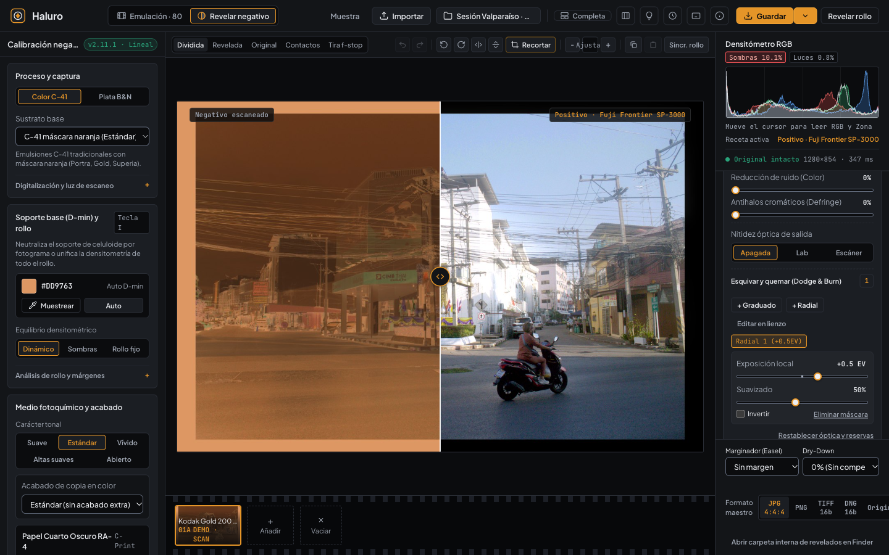
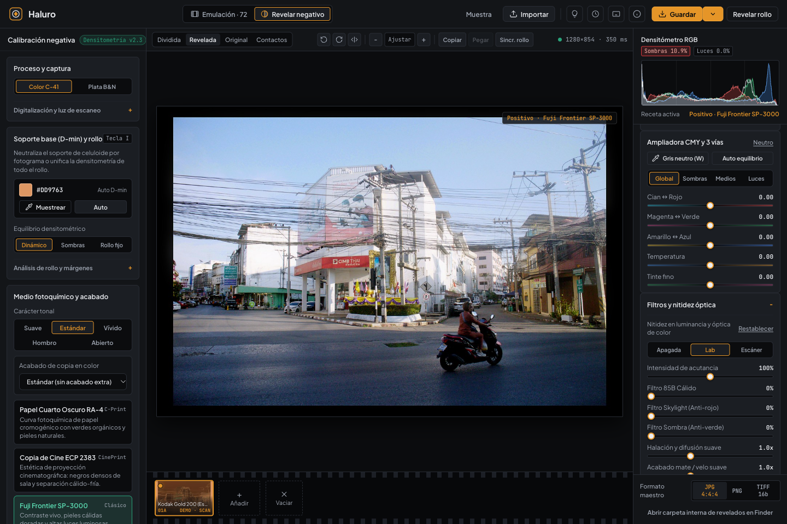

# Haluro 2.4.3 — Manual Oficial de Usuario y Guía de Cuarto Oscuro

Bienvenido al manual oficial de **Haluro**, una estación de trabajo fotográfica concebida desde la práctica y los principios de la fotoquímica analógica. Esta guía detalla cada módulo, herramienta, atajo de teclado y proceso de calibración para obtener el máximo rendimiento tanto en la inversión de negativos digitalizados con cámara como en la emulación de emulsiones cinematográficas y fotográficas clásicas.

---

## Tabla de Contenido

1. [Requisitos e Instalación](#1-requisitos-e-instalación)
   - [macOS (Apple Silicon e Intel)](#macos-apple-silicon-e-intel)
   - [Windows 11](#windows-11)
2. [Arquitectura de la Interfaz y Mesa de Luz](#2-arquitectura-de-la-interfaz-y-mesa-de-luz)
   - [Importación de Archivos](#importación-de-archivos)
   - [Visor Central y Herramientas de Inspección](#visor-central-y-herramientas-de-inspección)
   - [Atajos de Teclado Universales](#atajos-de-teclado-universales)
3. [Modo 1: Laboratorio de Inversión de Negativos](#3-modo-1-laboratorio-de-inversión-de-negativos)
   - [El Concepto Clave: D-min (Densidad Mínima)](#el-concepto-clave-d-min-densidad-mínima)
   - [Muestreo Óptico del Soporte Base](#muestreo-óptico-del-soporte-base)
   - [Perfiles de Escáner de Laboratorio (Fuji Frontier vs. Noritsu)](#perfiles-de-escáner-de-laboratorio-fuji-frontier-vs-noritsu)
   - [Cabezal Dicroico CMY y Balance de 3 Vías](#cabezal-dicroico-cmy-y-balance-de-3-vías)
   - [Control de Revelado: Forzado y Sub-revelado (Push/Pull)](#control-de-revelado-forzado-y-sub-revelado-pushpull)
4. [Modo 2: Cuarto Oscuro (Catálogo de Emulsiones)](#4-modo-2-cuarto-oscuro-catálogo-de-emulsiones)
   - [Las 72 Emulsiones Clásicas](#las-72-emulsiones-clásicas)
   - [Clasificación por Familias Fotoquímicas](#clasificación-por-familias-fotoquímicas)
   - [Ajustes de Química y Óptica](#ajustes-de-química-y-óptica)
5. [Efectos Fotoquímicos y Ópticos](#5-efectos-fotoquímicos-y-ópticos)
   - [Halación Analógica (Capa Antihalo)](#halación-analógica-capa-antihalo)
   - [Grano de Haluro de Plata (Cúbico vs. Tabular T-Grain)](#grano-de-haluro-de-plata-cúbico-vs-tabular-t-grain)
   - [Virados Químicos de Papel (B&N)](#virados-químicos-de-papel-bn)
6. [Metadatos Analógicos (Analog EXIF) y Exportación](#6-metadatos-analógicos-analog-exif-y-exportación)
   - [Registro de Cámara, Lente y Revelado](#registro-de-cámara-lente-y-revelado)
   - [Formatos de Salida (TIFF 16-bit vs. JPEG)](#formatos-de-salida-tiff-16-bit-vs-jpeg)
   - [Procesamiento por Lotes](#procesamiento-por-lotes)
7. [Preguntas Frecuentes y Resolución de Problemas](#7-preguntas-frecuentes-y-resolución-de-problemas)

---

## 1. Requisitos e Instalación

### macOS (Apple Silicon e Intel)

Haluro cuenta con paquetes nativos optimizados para las dos arquitecturas de computadores Apple:

| Arquitectura de Mac | Archivo a Descargar |
| :--- | :--- |
| **Apple Silicon (M1, M2, M3, M4)** | `Haluro-2.4.3-macOS-arm64.dmg` |
| **Procesadores Intel (Core i5, i7, i9, Xeon)** | `Haluro-2.4.3-macOS-x86_64.dmg` |

#### Pasos de Instalación:
1. Haz doble clic sobre el archivo `.dmg` correspondiente a tu procesador.
2. En la ventana que se abre, arrastra el icono de **Haluro** hacia el acceso directo de tu carpeta **Aplicaciones**.
3. Expulsa la imagen de disco y abre Haluro desde Launchpad, Spotlight o tu carpeta de Aplicaciones.

> [!IMPORTANT]
> **Primer arranque en macOS Sequoia (macOS 15) o Sonoma (macOS 14):**  
> Al ser una aplicación independiente y artesanal, el sistema Gatekeeper de Apple mostrará un diálogo preventivo: *«Apple no pudo verificar que Haluro no contenga software malicioso»*.  
> **Para autorizar la app por única vez:**
> 1. Haz clic en **«Listo»** en el cuadro de diálogo.
> 2. Dirígete a **Ajustes del Sistema () > Privacidad y seguridad** y baja hasta la sección **Seguridad**.
> 3. Haz clic en el botón **«Abrir de todos modos»** e ingresa la contraseña o Touch ID de tu Mac.  
> *(Alternativa rápida en Terminal: `xattr -cr /Applications/Haluro.app`)*. A partir de ese momento, la app abrirá de inmediato con doble clic.

---

### Windows 11

* **Archivo requerido:** `Haluro-Setup-2.4.3-Win11-x64.exe` (o la versión portátil `Haluro-Portable-2.4.3-Win11-x64.zip`).
* **Instalación:** Ejecuta el instalador. No requiere permisos de administrador forzados (instalación limpia por usuario) y se integra automáticamente con el motor **Microsoft Edge WebView2** preinstalado en Windows 11.

---

## 2. Arquitectura de la Interfaz y Mesa de Luz

La interfaz de Haluro está organizada en tres áreas principales diseñadas para minimizar la fatiga visual en sesiones prolongadas de edición:

1. **Barra Superior (Cabecera):**
   - Selector de modo: **«Modo Darkrooms»** (emulación de películas) vs. **«Modo Negativo»** (inversión química de negativos).
   - Acceso a muestras rápidas de calibración (`Cargar muestra RAW`).
   - Botón de importación manual (`Importar archivos`) y atajo `⌘O` / `Ctrl+O`.
   - Botón de exportación rápida (`Exportar copia`).

2. **Mesa de Luz Central:**
   - Área de previsualización con aceleración gráfica y soporte para pantallas Retina / High-DPI.
   - Densitómetro flotante en tiempo real: lee valores RGB normalizados en cualquier punto de la imagen.
   - Barra de herramientas inferior con controles de zoom (Ajustar, 100%, 200%), rotación y visualizador comparativo de pantalla dividida (Split Screen / Antes y Después).

3. **Paneles Laterales:**
   - **Panel Izquierdo:** Selección de emulsión (catálogo de 72 películas en modo Darkrooms) o calibración del soporte base D-min y perfiles de escáner (en modo Negativo).
   - **Panel Derecho (Inspector):** Parámetros de química analógica, curvas tonales, cabezal dicroico CMY, grano, halación y metadatos analógicos.

---

### Importación de Archivos

Haluro procesa de forma nativa los siguientes formatos:
* **Archivos RAW de cámara:** Canon (`.CR2`, `.CR3`), Nikon (`.NEF`), Sony (`.ARW`), Fujifilm (`.RAF`), Panasonic/Leica (`.RW2`), Olympus (`.ORF`) y negativos digitalizados en formato abierto `.DNG`.
* **Imágenes ráster de alta fidelidad:** `.TIFF` (8 y 16 bits por canal) y `.JPEG` de máxima calidad.

Para importar, basta con **arrastrar y soltar** uno o varios archivos directamente sobre la mesa de luz central, o presionar `⌘O` (`Ctrl+O` en Windows).

---

### Atajos de Teclado Universales

| Atajo (macOS) | Atajo (Windows) | Acción |
| :---: | :---: | :--- |
| `⌘ + O` | `Ctrl + O` | Abrir selector de archivos para importar |
| `I` | `I` | Activar cuentagotas para muestreo de soporte base D-min |
| `\` | `\` | Alternar vista comparativa (Original vs. Revelado) |
| `Espacio + Arrastrar` | `Espacio + Arrastrar` | Desplazamiento panorámico (Pan) sobre la mesa de luz |
| `⌘ + 0` | `Ctrl + 0` | Ajustar imagen completa al tamaño de la ventana |
| `⌘ + 1` | `Ctrl + 1` | Zoom 100% (píxel por píxel para evaluar grano y nitidez) |
| `⌘ + S` | `Ctrl + S` | Abrir cuadro de diálogo de exportación |
| `R` | `R` | Rotar imagen 90° en sentido horario |

---

## 3. Modo 1: Laboratorio de Inversión de Negativos

El **Modo Negativo** convierte digitalizaciones de película en copias positivas exactas utilizando física densitométrica en lugar de una simple inversión aritmética de curvas RGB.

### El Concepto Clave: D-min (Densidad Mínima)

En una película color negativa (como Kodak Portra o Fuji Superia), la película no es transparente: posee una **máscara naranja** compuesta por colorantes acopladores no expuestos. Esta densidad base se conoce en sensitometría como **D-min**.

Si se invierte un negativo sin restar matemáticamente el D-min exacto de esa emulsión, las sombras quedan contaminadas de cian y los medios tonos pierden fidelidad tonal.

---

### Muestreo Óptico del Soporte Base

1. Haz clic en la pestaña **«Modo Negativo»** en la barra superior.
2. En el panel izquierdo, ubica la sección **«Soporte base (D-min) y rollo»**.
3. Presiona la tecla `I` o pulsa sobre el icono del **Cuentagotas D-min**.
4. En el visor central, haz clic sobre una zona de película virgen no expuesta (el reborde perforado del carrete o el espacio entre fotogramas).
5. Haluro medirá los valores de absorción en 16 bits y neutralizará la máscara naranja de forma instantánea y no destructiva.

> [!TIP]
> **¿Qué hacer si el escaneo no tiene bordes visibles?**  
> Si tu fotografía fue recortada al ras y no tienes acceso al reborde virgen, pulsa el botón **«Equilibrio de escena (Sin bordes)»** en el panel derecho. El motor analizará el histograma de densidad de las sombras más densas para deducir el valor base del sustrato.

---

### Perfiles de Escáner de Laboratorio (Fuji Frontier vs. Noritsu)

Los dos escáneres más icónicos del mundo analógico interpretan los colores de manera deliberadamente diferente. Haluro incorpora matrices de caracterización espectral de ambos equipos:

* **Fuji Frontier SP-3000:**  
  * *Características:* Tonos de piel cálidos y dorados, sombras suaves con ligero tinte pastel, verdes naturales y alta tolerancia en altas luces.  
  * *Recomendado para:* Retratos, bodas, fotografía documental y luz de atardecer.
* **Noritsu HS-1800:**  
  * *Características:* Mayor contraste general, negros más profundos, nitidez de borde muy marcada y azules/rojos altamente saturados y vibrantes.  
  * *Recomendado para:* Paisajes, arquitectura, fotografía urbana y tomas de alto contraste.

---

### Cabezal Dicroico CMY y Balance de 3 Vías

Igual que en una ampliadora de laboratorio químico (como una LPL o Beseler con cabezal de color), la corrección de dominantes cromáticas se realiza mediante sustracción de color:

* **Cian (C):** Corrige el balance de rojos en la copia.
* **Magenta (M):** Controla la relación entre verdes y magentas (esencial para ajustar el matiz de la piel).
* **Amarillo (Y):** Calibra la calidez general neutralizando sombras azuladas.

El **Balance de 3 Vías** permite aislar estos ajustes por zonas de luminancia:
* **Sombras:** Corrige la base tonal de los tonos más oscuros sin afectar el cielo ni los rostros.
* **Medios Tonos:** Ajusta el cuerpo central de la exposición (tonos de piel, follaje, ropa).
* **Altas Luces:** Limpia los blancos puros evitando que se tiñan al mover la temperatura general.

---

### Control de Revelado: Forzado y Sub-revelado (Push/Pull)

El deslizador de **Proceso Químico (EV)** simula la variación del tiempo de permanencia del negativo en el baño de revelador (C-41 o D-76):
* **Push (+1 EV a +3 EV):** Aumenta el contraste de la curva característica (pendiente gamma más empinada) e incrementa el grano aparente. Ideal para negativos subexpuestos en la toma.
* **Pull (-1 EV a -2 EV):** Suaviza la respuesta tonal, expande el rango dinámico en altas luces y produce sombras abiertas y sedosas.

---

## 4. Modo 2: Cuarto Oscuro (Catálogo de Emulsiones)

El **Modo Darkrooms** aplica perfiles matemáticos y curvas características sensitométricas (pie, zona recta y hombro) sobre imágenes positivas (digitales o analógicas neutralizadas), recreando el comportamiento de 72 emulsiones de película legendarias.

### Las 72 Emulsiones Clásicas

El catálogo está clasificado en 5 familias químicas:

#### 1. Color Negativo (C-41)
* **Kodak Portra 160 / 400 / 800:** El estándar de la industria editorial. Separación tonal suave, grano fino y saturación contenida.
* **Kodak Ektar 100:** Grano ultrafino de tecnología T-Grain, microcontraste altísimo y colores vivos y saturados.
* **Kodak Gold 200 & ColorPlus 200:** El clásico tono cálido veraniego de los años 80 y 90, con dorados intensos y sombras cálidas.
* **Fujicolor Pro 400H:** Tonos de piel neutros con sombras ligeramente cian/verdosas y altas luces apasteladas.
* **Fujicolor Superia 400 / 800:** Grano vivaz y colores dinámicos para fotografía cotidiana de calle.

#### 2. Películas de Cine (ECN-2)
* **CineStill 800T (Tungsteno):** Emulsión cinematográfica Kodak Vision3 500T sin capa de carbón remjet. Diseñada para luz artificial nocturna (3200K), produce tonos fríos con característica halación rojiza en puntos de luz intensa.
* **CineStill 50D (Luz Día):** Grano prácticamente invisible y respuesta tonal suave para exteriores soleados.
* **Kodak Vision3 250D / 500T:** Las películas con las que se filma el cine contemporáneo de Hollywood.

#### 3. Blanco y Negro Clásico (Plata Coloidal Cúbica)
* **Kodak Tri-X 400:** El clásico del fotoperiodismo del siglo XX. Negros profundos, contraste contundente y grano orgánico marcado.
* **Ilford HP5 Plus 400:** La emulsión más versátil del laboratorio. Gradación tonal excepcionalmente amplia y sombras abiertas.
* **Ilford FP4 Plus 125:** Grano fino y detalle nítido para fotografía de estudio y paisajes.
* **Fomapan 100 / 400:** Estilo europeo tradicional de plata clásica con hombro suave en altas luces.

#### 4. Blanco y Negro Moderno (Haluros Tabulares T-Grain)
* **Kodak T-Max 100 / 400:** Emulsión con cristales de plata planos tabulares. Máxima resolución óptica y transición gris continua sin grano destructivo.
* **Ilford Delta 100 / 400 / 3200:** Rendimiento de alta velocidad con nitidez extrema en bajas condiciones de luz.

#### 5. Diapositiva / Reversible (E-6)
* **Fujichrome Velvia 50:** Máxima saturación, negros puros y contraste dramático. Legendaria en fotografía de naturaleza.
* **Fujichrome Provia 100F:** Fidelidad cromática estricta, neutralidad y grano ultrafino.
* **Kodak Ektachrome E100:** Tonos limpios, azules profundos y calidez controlada.
* **Kodachrome 64 (Proceso K-14):** La icónica emulsión de *National Geographic*, con rojos característicos y reproducción única del amarillo.

---

## 5. Efectos Fotoquímicos y Ópticos

Haluro no superpone capas transparentes de textura artificial. Cada efecto modela una propiedad física real de la materia fotográfica:

### Halación Analógica (Capa Antihalo)

En una película tradicional, la luz intensa atraviesa la emulsión y rebota en la base plástica hacia la capa roja, generando un halo difuso alrededor de los puntos luminosos.

* **Intensidad de Halación:** Controla la cantidad de dispersión de luz roja alrededor de las altas luces especulares (faroles, destellos solares, bombillas).
* **Radio Óptico:** Determina el alcance físico de la dispersión de fotones en la base del soporte.

---

### Grano de Haluro de Plata (Cúbico vs. Tabular T-Grain)

El grano fotográfico es el resultado de la acumulación microscópica de cúmulos de plata metálica reducida durante el revelado.

* **Modo de Grano Clásico (Cúbico):** Cristales tridimensionales irregulares. Produce una textura orgánica, crujiente y tridimensional, propia de películas como Tri-X, HP5 o Gold.
* **Modo de Grano Tabular (T-Grain):** Cristales laminares aplanados paralelos al soporte. Proporciona una superficie fina y regular, característica de T-Max y Delta.
* **Controles:**
  * *Intensidad:* Densidad de cúmulos de plata por milímetro cuadrado.
  * *Tamaño:* Equivalente a la sensibilidad ISO de la emulsión (fino para ISO 50/100, grueso para ISO 800/3200).
  * *Nitidez:* Controla la acutancia del grano (simula el uso de reveladores de alta acutancia como Rodinal vs. reveladores solventes como D-76).

---

### Virados Químicos de Papel (B&N)

En el laboratorio clásico, las copias en papel baritado se sumergen en baños metálicos secundarios para proteger la plata y modificar su matiz:

* **Selenio:** Reemplaza la plata libre por seleniuro de plata. Enfría sutilmente los tonos medios y profundiza drásticamente los negros (D-max) sin alterar las luces altas.
* **Sepia:** Convierte la plata en sulfuro de plata, otorgando una calidez nostálgica y permanente a la copia.
* **Cianotipia / Virado Azul:** Imprime un tono azul Prusia profundo en sombras y medios tonos.
* **Virado al Oro:** Proporciona un acabado rojizo cálido y protege contra la oxidación química por siglos.

---

## 6. Metadatos Analógicos (Analog EXIF) y Exportación

### Registro de Cámara, Lente y Revelado

Al trabajar con fotografía híbrida, la cámara digital que escanea el negativo sobrescribe los metadatos de la toma con los suyos (por ejemplo, «Sony A7 IV + Lente Macro 90mm»).

El cajón **«Metadatos Analógicos»** de Haluro te permite restituir la verdadera historia fotoquímica de la imagen:

* **Cámara Analógica:** (Ej. *Leica M6*, *Hasselblad 500 C/M*, *Pentax 67*, *Canon AE-1*).
* **Lente Clásico:** (Ej. *Carl Zeiss Planar 80mm f/2.8*, *Summicron 35mm f/2*).
* **Emulsión Utilizada:** (Ej. *Kodak Portra 400*).
* **Número de Rollo / Fotograma:** (Ej. *Rollo #12 - Frame 18*).
* **Laboratorio / Químico:** (Ej. *Revelado casero D-76 1+1 @ 20°C*).
* **Fecha de Exposición:** Fecha real en que se disparó la película.

Estos datos se incrustan en el estándar de metadatos EXIF/XMP del archivo resultante.

---

### Formatos de Salida (TIFF 16-bit vs. JPEG)

Haluro permite exportar en dos estándares profesionales:

1. **TIFF de 16 Bits (Recomendado para Archivo y Master):**
   - Espacio de color amplio sin pérdida de gradación tonal.
   - Ideal si piensas realizar impresiones de gran formato o ajustes posteriores en Photoshop.
2. **JPEG de Máxima Calidad (100% Calidad sRGB):**
   - Curva sRGB incrustada para visualización idéntica en pantallas Retina, iPhone, Android y redes sociales.
   - Metadatos optimizados para carga rápida sin pérdida de textura fotoquímica.

---

### Procesamiento por Lotes y Hoja de Contactos

Haluro incluye dos métodos optimizados para trabajar con rollos fotográficos completos:

1. **Hoja de Contactos Analógica en 1 Clic (Tecla `3`):**
   - Pulsa la pestaña **«Contactos»** para previsualizar al instante una cuadrícula de estilo laboratorio clásico con tipografía de emulsión, borde de chasis y numeración de fotogramas (DX 01A, 02A...).
   - **Composición instantánea:** Se procesa concurrentemente en memoria en menos de 1 segundo sin tocar el disco.

2. **Guardar Exclusivamente la Hoja de Contactos:**
   - Si solo deseas archivar o compartir la hoja de contactos sin tener que exportar cada fotograma individual a tu disco, utiliza el botón **«Guardar contactos»** en la barra superior o los botones flotantes sobre la hoja. Se exportará un archivo JPEG de alta resolución de archivo (`Haluro_Contactos_...jpg`).

3. **Revelar Rollo Completo (Motor Multinúcleo):**
   - El botón **«Revelar rollo»** procesa todos los fotogramas del carrete a máxima resolución nativa (TIFF 16-bit o JPEG) aprovechando todos los núcleos de tu procesador en paralelo, e incluye automáticamente la hoja de contactos `SHEET.jpg` dentro de la carpeta del rollo.

---

## 7. Preguntas Frecuentes y Resolución de Problemas

#### ¿Por qué el visor se ve oscuro o con tinte extraño al abrir mi RAW?
Asegúrate de haber seleccionado el perfil de iluminación correcto en **«Proceso y captura»**. Si utilizas una mesa de luz LED económica con índice de reproducción cromática bajo (CRI < 90), activa la compensación de luz fría para equilibrar el espectro del sensor.

#### En Mac, ¿cómo evito tener que ir a Ajustes cada vez que abro la app?
El aviso de seguridad de macOS Sequoia solo aparece **una única vez** tras descargar el archivo de internet. Una vez que pulsas *«Abrir de todos modos»* en *Ajustes del Sistema > Privacidad y seguridad*, tu Mac recuerda la autorización de forma permanente.

#### ¿Puedo guardar mis propias fórmulas de revelado?
Sí. En la esquina superior derecha del panel Inspector puedes hacer clic en **«Guardar Preset»** para almacenar tu combinación favorita de película, grano, halación y virado dicroico bajo un nombre personalizado.

#### ¿Cómo mantengo Haluro actualizado con las últimas mejoras?
Haluro incluye un sistema inteligente y 100% privado de actualización. Cada vez que inicias la aplicación (o al pulsar **«Comprobar ahora»** en la ventana *Acerca de*), Haluro consulta en segundo plano si existe una nueva versión oficial en GitHub. Si hay una versión más reciente, verás un distintivo sutil en la barra superior (`✨ Nueva versión`) que te mostrará las novedades y te permitirá descargar el instalador específico para tu equipo (macOS Apple Silicon, macOS Intel o Windows) en un solo clic.

---

*Haluro 2.4.3 — Desarrollado para fotógrafos que aman la ciencia y el arte de la plata.*
