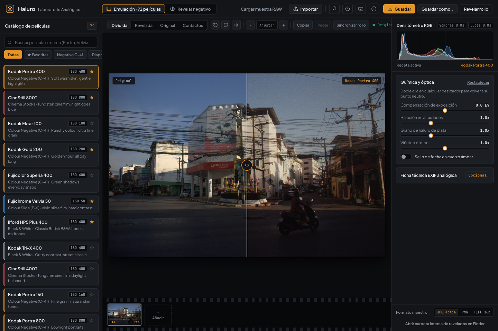
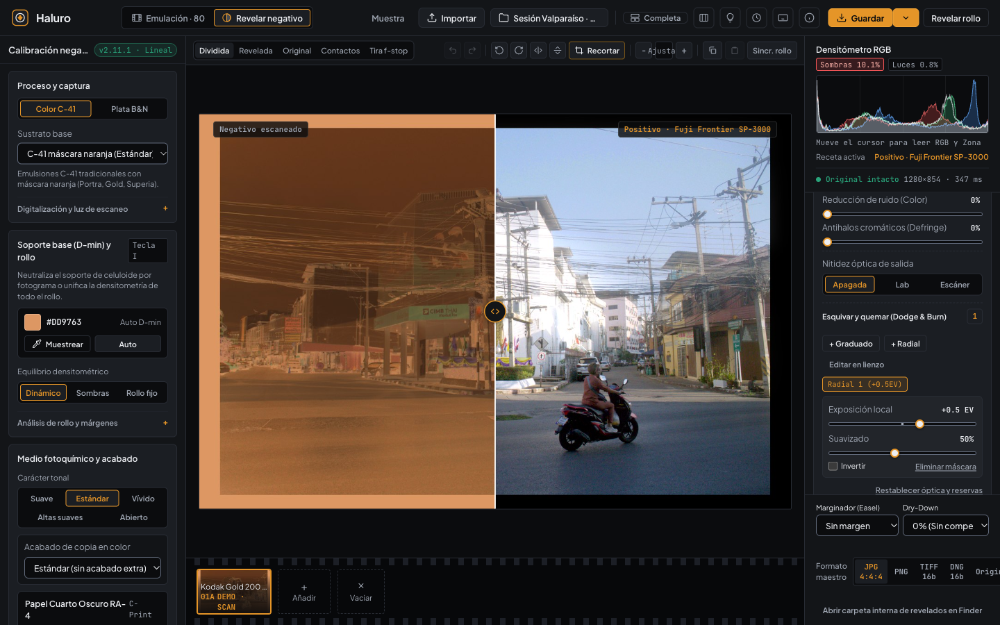
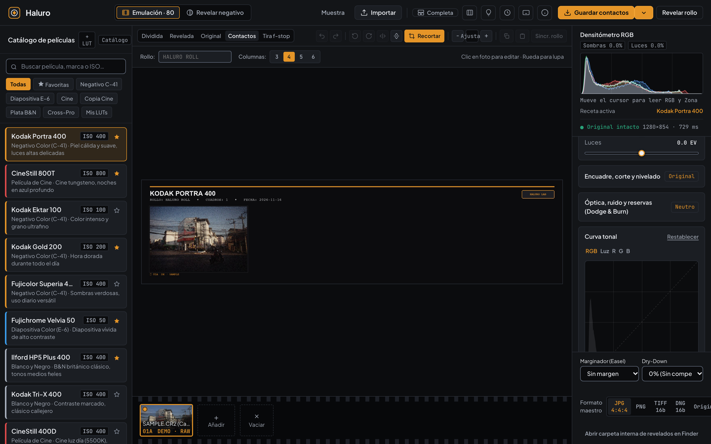
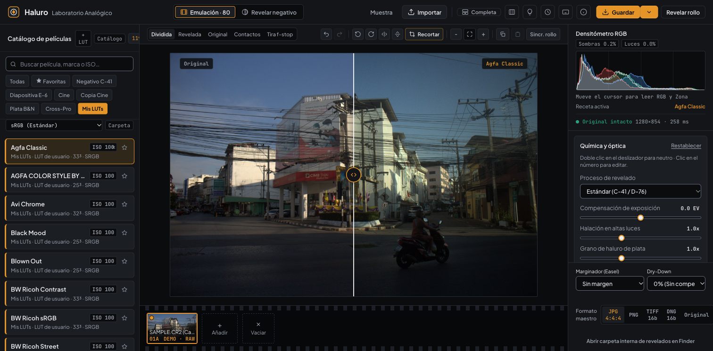
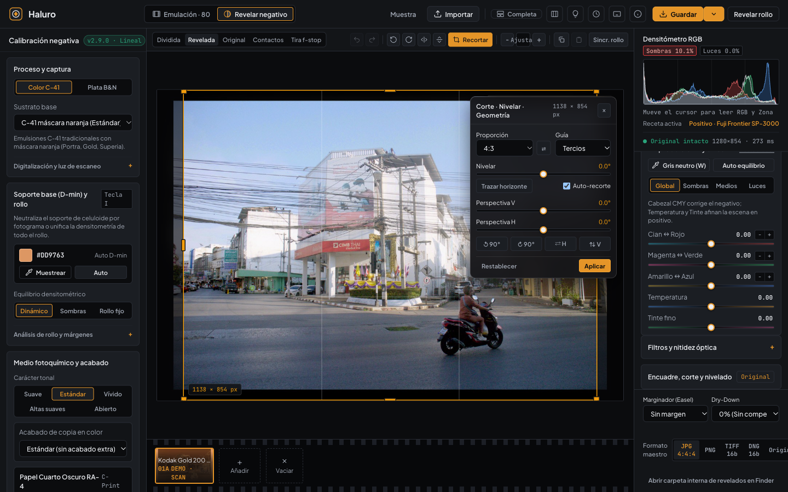
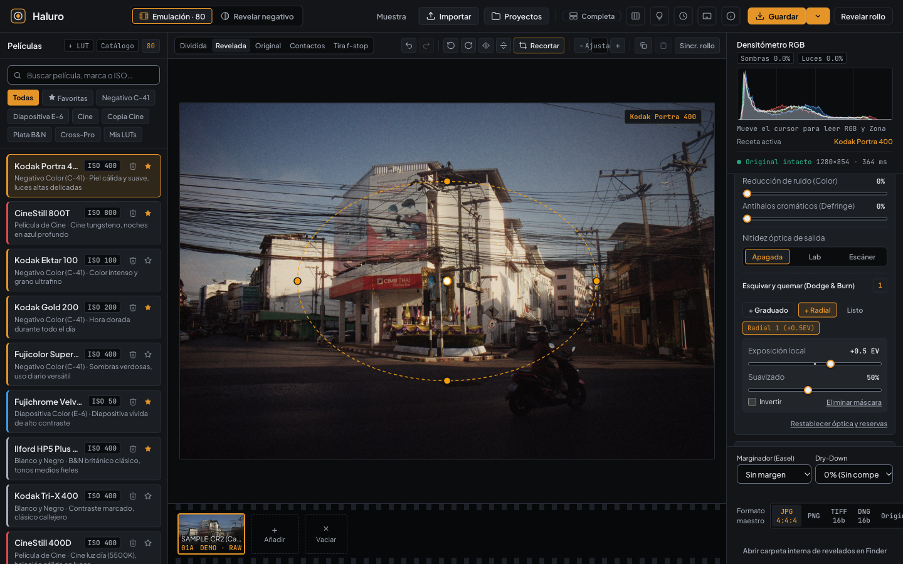

# Haluro — Laboratorio Analógico Digital (v2.10.0)

[](LICENSE)
[](#requisitos-técnicos)
[](tests/)
[-brightgreen.svg)](#seguridad-y-privacidad)
[](#seguridad-y-privacidad)
[](#principios-de-diseño-y-calidad)

> **Desarrollador y Autor:** Fotógrafo **César Fernández Ardiles**  
> **Estudio / Origen:** Oregano · Chile  
> **Propósito:** Software libre y de código abierto para fotógrafos analógicos y laboratorios independientes.  
> **Documentación Oficial:** 📖 [Manual de Uso y Guía de Cuarto Oscuro](MANUAL_DE_USO.md) · 🖨️ [Guía Web Interactiva e Imprimible](manual.html)

---

## Índice

1. [Novedades y Registro de Cambios](#novedades-y-registro-de-cambios)
2. [¿Qué es Haluro?](#qué-es-haluro)
3. [Principios de Diseño y Calidad](#principios-de-diseño-y-calidad)
4. [Módulos y Características](#módulos-y-características)
5. [Requisitos Técnicos](#requisitos-técnicos)
6. [Instalación y Ejecución](#instalación-y-ejecución)
7. [Diagrama del Flujo de Trabajo](#diagrama-del-flujo-de-trabajo)
8. [Seguridad y Privacidad](#seguridad-y-privacidad)
9. [Cumplimiento Legal y Derechos de Autor](#cumplimiento-legal-y-derechos-de-autor)
10. [Compilación y Publicación de Releases](#compilación-y-publicación-de-releases)
11. [Créditos y Agradecimientos](#créditos-y-agradecimientos)

---

## Novedades y Registro de Cambios

El historial completo de versiones está en [CHANGELOG.md](CHANGELOG.md). Las mejoras estructurales recientes del motor incluyen:

- **LUTs 3D de usuario (`.cube`):** importación directa desde la pestaña **Mis LUTs** con validación previa, soporte para 6 espacios de color de entrada y carpeta dedicada `user_luts/`.
- **Consistencia de grano entre vista previa y exportación:** el grano usa una semilla determinista por fotograma para mantener la misma estructura entre la vista previa y el archivo exportado.
- **Preservación de escaneos de 16 bits:** la normalización respeta el rango de 16 bits (`65535`) evitando pérdidas de precisión en negativos subexpuestos.
- **Inversión sensitométrica Hurter–Driffield:** la transferencia densitométrica respeta el contraste real del negativo y elimina el roll-off que comprimía el blanco sRGB en las 80 películas del catálogo.
- **Accesibilidad de teclado y memoria en lotes:** `Tab` conserva la navegación estándar (`⌘+Alt+Z` / `Ctrl+Alt+Z` alterna paneles) y la hoja de contactos reduce cada fotograma a miniatura al cargarlo para evitar cierres por falta de memoria en rollos de 36 exposiciones.
- **Sesión local protegida:** token CSRF por proceso, cabecera `Host` restringida a loopback, verificación de `Origin`, validación de rutas y servidor WSGI Waitress.

---

## ¿Qué es Haluro?

**Haluro** es una estación de trabajo fotográfica de escritorio nativa para **macOS** y **Windows 10/11** con procesamiento interno en coma flotante de 32 bits y exportación de hasta 16 bits por canal:

1. **Emulación Analógica:** Emulación colorimétrica de **80 películas fotográficas y cinematográficas** (Kodak Portra, Tri-X, Ektachrome, Fuji Velvia, Provia, Neopan, Ilford HP5+, Delta, CineStill 800T, etc.) mediante interpolación trilineal 3D LUT. Incluye grano 2D con semilla determinista por fotograma, halo rojo de capa antihalo, viñeteo óptico y soporte para **LUTs 3D de usuario (`.cube`)** en la pestaña **Mis LUTs**.
2. **Revelado Digital de Negativos:** Inversión sensitométrica basada en el modelo **Hurter–Driffield (H&D)** para negativos color (C-41) y blanco y negro digitalizados mediante escáner plano, escáner dedicado de película o cámara digital con fuente de luz LED. Compensa la máscara naranja (D-min), desacopla el balance de blancos de la escena y emula la respuesta tonal de papeles fotográficos tradicionales (**Fuji Crystal Archive RA-4**), películas de impresión de cine (**Kodak Vision 2383 ECP**), escáneres/minilabs (**Noritsu / Frontier**) y el perfil logarítmico **V-Log**.


*Mesa de luz en modo **Emulación · 80** con vista dividida, catálogo en español e histograma Densitómetro RGB.*


*Laboratorio de **Revelado Negativo** (C-41 · Fuji Frontier SP-3000) con muestreo de soporte base (D-min), `Densidad neutra (Medios)` y ampliación dicroica.*


*Pestaña interactiva **Contactos** (`HALURO · SERIE 35MM`) con cuadrícula configurable (3 a 6 columnas), zoom panorámico y exportación contextual con `Guardar contactos`.*


*Pestaña **Mis LUTs** con importación directa de archivos `.cube` (`+ LUT`), selector de espacio de color de entrada (`sRGB`, `Rec.709`, `S-Log3`, `ARRI LogC3`, `Cineon`, `Linear`) y acceso directo a la carpeta de usuario.*

---

## Principios de Diseño y Calidad

- **Edición No Destructiva:** Los archivos originales cargados (`.CR2`, `.CR3`, `.NEF`, `.ARW`, `.DNG`, `.TIFF`, `.PNG`, `.JPG`, `.HEIF`, `.WebP`, `.BMP`) no se modifican ni sobrescriben; Haluro genera copias maestras independientes.
- **Arquitectura Local-First y Privacidad:** No requiere cuenta de usuario, no utiliza conexión a la nube ni envía telemetría. Todo el cómputo se realiza localmente mediante la interfaz de bucle invertido (`127.0.0.1`), sin peticiones externas salvo la comprobación manual de actualizaciones en *Acerca de*.
- **Paridad Nativa entre Sistemas Operativos:** En macOS se integra con **Cocoa WebKit**, soporte HiDPI (Retina) y atajos `⌘`. En Windows 10/11 utiliza **Microsoft Edge WebView2**, soporte por monitor v2 High-DPI, barra de título oscura integrada mediante DWM (Desktop Window Manager) y atajos `Ctrl`.
- **Exportación Maestra en 16 bits:** Soporta guardado en **TIFF RGB de 48 bits** (`uint16` por canal) con compresión Adobe Deflate sin pérdida a 300 DPI, además de PNG y JPEG 4:4:4.
- **Ficha Técnica Analógica EXIF Nativa:** Inyecta en las etiquetas EXIF Sub-IFD estándar la cámara analógica utilizada, objetivo, emulsión, formato de rollo, ISO de exposición, proceso químico de revelado, modelo de escáner y autoría.

---

## Módulos y Características

### Módulo 1 — Laboratorio B&N: Virados Químicos y Papeles *Fine-Art*

- **10 Procesos de Virado Químico:**
  - `neutral` (Plata pura neutra sobre base blanca).
  - `selenium_1`, `selenium_2`, `selenium_3` (Virado al selenio en tres grados de profundidad: sutil, clásico y profundo).
  - `palladium` (Platino / Paladio cálido de rango dinámico extendido).
  - `sepia_sulfide` (Virado al sulfuro tradicional con medios tonos ocres).
  - `copper_iron` (Virado al cobre/hierro rojizo).
  - `warmtone_foma` (Emulsión de clorobromuro sobre papel baritado cálido).
  - `cooltone` (Bromuro de plata frío con sombras azuladas profundas).
  - `cotton_matte` (Papel 100% algodón mate con negros abiertos y textura suave).
- Control continuo de intensidad (`0%` a `150%`) y preservación tonal de la base de papel.

### Módulo 2 — Análisis Unificado de Rollo (*Roll Analysis*)

- Calibración densitométrica unificada para múltiples fotogramas de un mismo carrete.
- Evita el **"bombeo de exposición"** (*exposure pumping*) entre tomas con iluminaciones dispares.
- Modos de equilibrio de color: `dynamic` (balance independiente por toma), `shadow_weighted` (prioridad a sombras profundas) y `roll_locked` (bloqueo densitométrico estricto del rollo analizado).
- Perfiles de origen de captura: `camera_raw` (digitalización con cámara mirrorless/DSLR), `scanner_raw` (escaneo lineal sin procesar) y `flatbed_tiff` (escáner plano EPSON/Canon).
- Regulador óptico de **Pre-Saturación** (`0.50x` a `1.60x`) aplicado en el espacio de exposición logarítmica Hurter–Driffield.

### Módulo 3 — Etalonaje CMY de 3 Vías y Recorte Protegido

- Corrección de color de laboratorio mediante filtrado sustractivo **Cian**, **Magenta** y **Amarillo** (CMY).
- Ruedas tonales independientes: **Global**, **Sombras**, **Medios Tonos** y **Altas Luces**, con umbrales configurables de rango tonal.
- **Color-Protected Soft Clip:** Deslizadores de recorte de punto negro (`black_clip`) y blanco (`white_clip`) con protección cromática activa (`clip_protect`) para impedir cambios bruscos de matiz o tintes no deseados en sombras profundas y altas luces especulares.

### Módulo 4 — Acabados de Copia (*Print Finishing*)

- 7 estilos de acabado posterior a la inversión (además de `none` para desactivarlo):
  - `crystal_archive` (Papel comercial Fuji Crystal Archive).
  - `portra_airy` (Altas luces abiertas y tonos de piel luminosos).
  - `gold_warm` (Calidez dorada de emulsión doméstica).
  - `superia_cool` (Copia fría contemporánea).
  - `cine_halation` (Resplandor cálido en transición de altas luces).
  - `portrait_soft` (Contraste atenuado para retrato).
  - `clean_contrast` (Contraste nítido para fotografía de calle y arquitectura).
- Variantes tonales asimétricas: `soft`, `standard`, `vivid`, `highlight_soft` y `shadow_soft`.

### Módulo 5 — Nitidez Óptica de Cuarto Oscuro en Luminancia

- Filtro de acutancia selectiva aplicada en el canal de luminancia (Y) en modos `lab` o `scanner`.
- Protección anti-grano adaptativa: modula la ganancia en función de la luminancia para no amplificar el ruido en sombras ni alterar la estructura del grano.

### Módulo 6 — Ficha Técnica Analógica EXIF, Hoja de Contactos y Exportación Maestra

- Escritura nativa en etiquetas EXIF estándar (`Make`, `Model`, `LensModel`, `ISOSpeedRatings`, `Artist`, `ImageDescription` y `UserComment` Unicode UTF-16) desde **Ficha técnica EXIF analógica**.
- Autocompletado con sugerencias rápidas para cámaras clásicas (Leica, Hasselblad, Pentax, Canon, Nikon, Mamiya, Rolleiflex) y películas reconocidas.
- Botones **"Copiar pie técnico"** para pegar la ficha completa en redes sociales o catálogos y **"Limpiar ficha"** para reiniciar los metadatos de sesión.
- **Hoja de Contactos interactiva (pestaña `Contactos`, tecla `3`):** vista en vivo configurable de 3 a 6 columnas con zoom mediante rueda del ratón y paneo, edición directa al hacer clic en cualquier cuadro e indicadores ámbar en la tira inferior para fotogramas editados.
- **Exportación individual y por lotes:** guardado rápido (`⌘S` / `Ctrl+S`), `Guardar como…` (`⇧⌘S` / `Ctrl+Shift+S`), botón contextual **Guardar contactos** / **Guardar solo contactos** y **Revelar rollo** multinúcleo con barra de progreso fotograma a fotograma y cancelación inmediata.
- **Historial no destructivo y navegación:** deshacer/rehacer (`⌘Z` / `Ctrl+Z` y `⇧⌘Z` / `Ctrl+Shift+Z`), cambio de fotograma con `←` / `→`, copiar/pegar recetas (`⇧⌘C` / `Ctrl+Shift+C` y `⇧⌘V` / `Ctrl+Shift+V`) y `Sincronizar rollo`.

### Módulo 7 — Geometría Unificada, Óptica Compartida, Dodge & Burn y Linear DNG 16-bit

Disponible de forma idéntica tanto en **Emulación · 80** como en **Revelar negativo**:

- **Recorte y Nivelación sobre Lienzo (`C`):** Marco interactivo con relaciones de aspecto (`Libre`, `Original`, `1:1`, `4:3`, `3:2`, `16:9`, `5:4`, `6:7`), botón `⇄` para invertir orientación, nivelación fina (`±15°`) y herramienta **Trazar horizonte** en dos clics. También incluye corrección de perspectiva vertical (**Keystone**), rotación `90°`, volteo H/V, auto-recorte y guías de composición (*Tercios, Áurea, Diagonal, Centro*) con lectura de píxeles en vivo.
- **Limpieza, Ruido, Defringe y Enfoque:** Eliminación puntual de polvo/motas sobre el lienzo, reducción de ruido digital (luminancia y crominancia), supresión de halos cromáticos (**Defringe**) y enfoque de laboratorio o escáner.
- **Dodge & Burn Local:** Hasta 8 máscaras interactivas de **gradiente lineal** o **radial** con ajuste independiente de exposición, suavidad e inversión.
- **Formato `Original`, `Linear DNG 16-bit` y Sidecar `.XMP`:** Conserva el formato original en imágenes raster, mientras que los archivos RAW se exportan como DNG lineal de 16 bits sin pérdida; además genera automáticamente un archivo `.xmp` con la receta analógica y la geometría.

| Geometría, Recorte y Nivelación | Óptica Compartida y Dodge & Burn Local |
| :---: | :---: |
|  |  |

### Módulo 8 — LUTs 3D de Usuario (`.cube`)

- **Importación directa (`+ LUT`):** Carga uno o varios archivos `.cube` (1D shaper y/o grilla 3D) desde la pestaña **Mis LUTs**, con validación previa de tablas y normalización de extensiones duplicadas (`.cube.cube`).
- **Espacios de entrada:** Soporta `sRGB`, `Rec.709`, `S-Log3`, `ARRI LogC3`, `Cineon` y `Linear`.
- **Gestión local:** Acceso directo a `user_luts/` mediante el botón **Carpeta** y eliminación individual desde cada tarjeta (`×`).

---

## Requisitos Técnicos

### Para macOS

- **Sistema Operativo:** macOS 11.0 (Big Sur) o superior.
- **Arquitectura:** Apple Silicon nativo (`arm64` — M1, M2, M3, M4) o procesadores Intel (`x86_64`).
- **Motor Webview:** WebKit nativo incluido en el sistema operativo (no requiere Chromium ni Electron).

### Para Windows 10/11

- **Sistema Operativo:** Windows 11 (64-bit) o Windows 10 Versión 2004+ (Build 19041+).
- **Arquitectura:** x64 nativo o ARM64 (mediante la capa de emulación x64 integrada en Windows 11).
- **Motor Webview:** **Microsoft Edge WebView2 Runtime** (preinstalado en Windows 11).
- **Interfaz Gráfica:** Integración con DWM Dark Mode y compatibilidad con monitores de alta densidad de píxeles (High-DPI v2).

### Hardware Recomendado

- **Memoria RAM:** 8 GB mínimo (16 GB recomendado para digitalizaciones RAW de 45+ megapíxeles).
- **Almacenamiento:** 250 MB de espacio libre en disco para la aplicación.
- **Pantalla:** Calibrada en espacio sRGB o Display-P3 (mínimo 1280×800, recomendado 1920×1080 o superior).

---

## Instalación y Ejecución

### A) macOS (Nativo)

#### Opción 1: Imagen de Disco Oficial (.dmg)

1. Descarga la versión adecuada para tu procesador desde [Releases de GitHub](https://github.com/Hermesuser/haluro/releases):
   - **Apple Silicon (M1 / M2 / M3 / M4):** `Haluro-<version>-macOS-arm64.dmg`
   - **Procesadores Intel (Core i5 / i7 / i9 / Xeon):** `Haluro-<version>-macOS-x86_64.dmg`
2. Haz doble clic sobre el archivo `.dmg` montado y arrastra el icono de **Haluro** hacia tu carpeta de **Aplicaciones**.
3. Abre **Haluro** desde Launchpad, Spotlight o tu carpeta de **Aplicaciones**.
   > **Nota para el primer arranque en macOS Sequoia / Sonoma:**  
   > Al no estar firmada con un certificado de Apple Developer, puede aparecer una advertencia de Gatekeeper (*«Apple no pudo verificar que Haluro no contenga software malicioso»*). Para autorizarla por única vez:
   >
   > 1. Haz clic en **«Listo»** en el cuadro de diálogo.
   > 2. Abre **Ajustes del Sistema  > Privacidad y seguridad** y baja hasta el apartado **Seguridad**.
   > 3. Haz clic en el botón **«Abrir de todos modos»** y confirma con tu contraseña o Touch ID.
   >
   > *(Alternativa rápida en Terminal: `xattr -cr /Applications/Haluro.app`)*. A partir de ese momento abrirá con doble clic.

#### Opción 2: Ejecución desde código fuente

```bash
# Clonar el repositorio
git clone https://github.com/Hermesuser/haluro.git
cd haluro

# Ejecutar el lanzador nativo de macOS
chmod +x run.sh
./run.sh
```

### B) Windows 10/11 (Nativo)

#### Opción 1: Instalador (Setup .exe)

1. Descarga `Haluro-Setup-<version>-Win11-x64.exe` desde [Releases de GitHub](https://github.com/Hermesuser/haluro/releases).
2. Ejecuta el instalador. No requiere permisos de administrador (instalación en espacio de usuario sin elevación UAC).
3. Inicia Haluro desde el Menú Inicio o el acceso directo del Escritorio.

#### Opción 2: Versión Portátil (.zip)

1. Descarga `Haluro-Portable-<version>-Win11-x64.zip` desde [Releases de GitHub](https://github.com/Hermesuser/haluro/releases).
2. Descomprime la carpeta en cualquier ubicación (por ejemplo, `C:\Programas\Haluro`).
3. Ejecuta `Haluro.exe`.

#### Opción 3: Ejecución desde código fuente

```cmd
:: Clonar el repositorio y entrar en la carpeta del proyecto
git clone https://github.com/Hermesuser/haluro.git
cd haluro
run_windows.bat
```

### C) Interfaz de Línea de Comandos (CLI)

Haluro incluye una interfaz de línea de comandos (CLI) para automatización y procesamiento por lotes sin interfaz gráfica:

```bash
# Consultar versión y autor
python cli.py --version
python cli.py about

# Listar emulsiones disponibles (por ejemplo, categoría negativo C-41)
python cli.py list --category neg

# Emular película sobre una fotografía RAW
python cli.py develop captura.cr2 --film portra400 --format tiff --out ./reveladas

# Revelar un negativo C-41 digitalizado con cámara
python cli.py invert negativo_01.tif \
  --profile frontier \
  --scan-source camera_raw \
  --tone highlight_soft \
  --print-finish crystal_archive \
  --format tiff \
  --camera "Leica M6" \
  --film-stock "Kodak Portra 400" \
  --iso 400 \
  --out ./positivos
```

---

## Diagrama del Flujo de Trabajo

```text
                ┌────────────────────────────────────────────────┐
                │ Importar RAW / TIFF / DNG / PNG / JPG / HEIF / │
                │                  WebP / BMP                    │
                └───────────────────────┬────────────────────────┘
                                        │
                 ┌──────────────────────┴──────────────────────┐
                 ▼                                             ▼
     [Modo 1: Emulación · 80 + Mis LUTs]           [Modo 2: Revelar negativo]
     - Catálogo de 80 emulsiones + .cube propios   - Proceso Color C-41 o Plata B&N e iluminación
     - Proceso químico (Normal/Stand/Push/Pull)    - Sustratos sin máscara y rebordes/sprockets
     - Zonas tonales, grano y curva compartida     - Curva tonal, Split Grade B&N y limpieza puntual
     - Sello de fecha, reciprocidad y marginador   - Ampliadora CMY, Flat-Field LED y F-Stop Strip
                 │                                             │
                 └──────────────────────┬──────────────────────┘
                                        │
                                        ▼
                ┌────────────────────────────────────────────────┐
                │   Geometría, Óptica, Dodge & Burn y Contactos  │
                │    Ficha Técnica Analógica EXIF Nativa         │
                └───────────────────────┬────────────────────────┘
                                        │
                                        ▼
                ┌────────────────────────────────────────────────┐
                │       Exportación Maestra No Destructiva       │
                │  (Original · DNG 16b · TIFF 16b · PNG · JPG)   │
                └────────────────────────────────────────────────┘
```

---

## Seguridad y Privacidad

1. **Aislamiento de Red:** Haluro no realiza peticiones a Internet en tiempo de ejecución, salvo la comprobación opcional de actualizaciones que el usuario puede iniciar desde el panel *Acerca de*. Las tipografías (*Plus Jakarta Sans* y *JetBrains Mono*) están alojadas localmente en el paquete en formato WOFF2.
2. **Sesión Local Protegida:** El motor solo escucha en `127.0.0.1` y además aplica tres capas: cabecera `Host` restringida a direcciones de loopback (bloquea *DNS rebinding*), verificación del origen `Origin` en cada petición que modifica estado (bloquea el *cross-site POST* desde páginas ajenas) y un **token CSRF por proceso** que el frontend inyecta en cada petición y el servidor exige en todos los `POST`, `PUT`, `PATCH` y `DELETE`.
3. **Política de Seguridad de Contenido (CSP):**

   ```http
   Content-Security-Policy: default-src 'self'; img-src 'self' data: blob:; style-src 'self' 'unsafe-inline'; font-src 'self' data:; script-src 'self'; connect-src 'self'; object-src 'none'; base-uri 'none'; form-action 'self'; frame-src 'none'; frame-ancestors 'none';
   ```

   Se acompañan de `X-Content-Type-Options: nosniff`, `X-Frame-Options: DENY`, `Referrer-Policy: no-referrer` y `Cross-Origin-Resource-Policy: same-origin`.
4. **Validación de Rutas Seguras:** Las claves de película y de perfil negativo se canonicalizan contra el catálogo, nunca se interpolan sin verificar, y toda ruta de salida se comprueba contra su directorio permitido para impedir saltos de directorio (*path traversal*).
5. **Validación de Entrada:** Todos los parámetros numéricos se acotan a rangos válidos y se rechazan con **HTTP 400** los valores no numéricos, no finitos o fuera de rango. Las subidas se validan por contenido real, no solo por extensión.
6. **Servidor de Producción:** El backend se sirve con **Waitress** (WSGI de producción) en lugar del servidor de desarrollo de Flask, sin *debugger* interactivo y con límites de conexión y tiempo de espera.
7. **Auditoría de Vulnerabilidades (`pip-audit`):** El entorno de compilación fijado al publicar la `v2.10.0` utiliza `Pillow >= 13.0.0`, con **0 vulnerabilidades conocidas** en las dependencias declaradas según `pip-audit`.
8. **Escrituras Atómicas:** Toda exportación se escribe en un archivo temporal y se mueve a su destino con `os.replace()`, para evitar archivos truncados ante interrupciones del proceso dentro del mismo sistema de archivos.
9. **Calidad de Código y Pruebas Automatizadas:** Suite de **110 pruebas automatizadas (`pytest`)** que verifican la inversión H&D, el motor de densidad neutra, la geometría (recorte, nivelación, keystone), la óptica compartida (limpieza puntual, reducción de ruido, defringe, dodge & burn local), los LUTs de usuario (`.cube`), la exportación a **Linear DNG 16-bit** y sidecar `.XMP`, la hoja de contactos, el progreso de revelado por lotes, la persistencia EXIF y las protecciones de sesión, ruta y validación de entrada. La CI ejecuta además `ruff` y un guardián de coherencia de versión.

---

## Cumplimiento Legal y Derechos de Autor

- **Código Fuente:** Licenciado bajo la **Licencia MIT** (Copyright &copy; 2026 César Fernández Ardiles, Oregano, Chile).
- **Tablas de Emulación 3D (CLUTs):** Los archivos `.cube` incluidos en `luts/` provienen de la colección de código abierto desarrollada por **Pat David (PIXLS.US)**, **GREYC/G'MIC** y **RawTherapee**, bajo licencia **Creative Commons Atribución-CompartirIgual 4.0 Internacional (CC BY-SA 4.0)**. El código fuente MIT de Haluro se mantiene independiente; si distribuyes una variante que incruste esas tablas, aplican las obligaciones *copyleft* de CC BY-SA 4.0 sobre el conjunto.
- **Tipografías:** Distribuidas bajo la licencia **SIL Open Font License 1.1** (OFL).
- **Cláusula de Marcas Nominativas:** Nombres como *Kodak, Fujifilm, Ilford, Agfa, CineStill, Rollei, Noritsu, Frontier, Foma* o *Adobe* se citan exclusivamente de forma informativa (*nominative fair use*) para describir el tipo de material analógico que el software aproxima. Haluro es un proyecto independiente y no cuenta con afiliación, patrocinio ni respaldo de dichas compañías.
- Consulta [THIRD_PARTY_NOTICES.md](THIRD_PARTY_NOTICES.md) para el detalle de cada componente.

---

## Compilación y Publicación de Releases

Haluro incluye un flujo de integración continua en `.github/workflows/release.yml` y empaquetadores locales en `packaging/`:

### Empaquetado local en macOS (ARM64 / Intel)

```bash
# Ejecuta pytest, --smoke-test, PyInstaller, firma ad-hoc y empaquetado .dmg
bash packaging/macos/build_macos.sh
```

### Publicación automática en GitHub Releases

La versión se resuelve desde `engine/__init__.py`. Al crear y subir una etiqueta `v<version>`:

```bash
git tag -a v<version> -m "Haluro v<version>"
git push origin v<version>
```

GitHub Actions ejecuta la **puerta de calidad** (`ruff`, `pip-audit`, `pytest`, `--smoke-test` y el guardián de versión) y compila los paquetes `.dmg` de macOS (Apple Silicon e Intel) y los instaladores `.exe` de Windows 10/11, adjuntándolos al Release con sus sumas SHA-256.

---

## Créditos y Agradecimientos

- **César Fernández Ardiles** (Fotógrafo y desarrollador, Oregano · Chile): Diseño de arquitectura, implementación sensitométrica Hurter-Driffield, interfaz de usuario y desarrollo general.
- **Pat David & Comunidad PIXLS.US / RawTherapee / G'MIC**: Por su trabajo en la documentación y preservación de perfiles de color analógico en software libre.
- **Maik Riechert & Equipo de LibRaw**: Por el motor de decodificación de archivos RAW fotográficos.
- **Equipo de pywebview & Pallets (Flask)**: Por proporcionar las bases ligeras para crear aplicaciones de escritorio desacopladas de Chromium.

---

**Haluro — Fotografía analógica y revelado digital local-first.**  
Hecho en Chile · 2026
